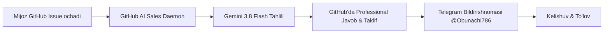

# 🤖 GitHub AI Sales & Lead Generation Agent (Gemini 3.8 Flash + Telegram)

[](https://python.org)
[](https://ai.google.dev/)
[](https://t.me/Obunachi786)
[](LICENSE)

**GitHub AI Sales Agent** — GitHub repozitoriyalaridagi barcha yangi issue, savol va muhokamalarni real vaqt rejimida kuzatib boruvchi, Google Gemini 3.8 Flash intellekti orqali ularga professional va sotuvga yo'naltirilgan javob beruvchi, hamda har bir potentsial mijozni Telegram orqali egasiga yetkazib beruvchi avtonom AI tizimi.

---

## 🌟 Asosiy Xususiyatlari

1. **24/7 Avtomatlashgan Monitoring:**
   - GitHub CLI (`gh`) orqali barcha ochiq repozitoriyalarni (yoki ko'rsatilgan loyihalarni) doimiy nazorat qiladi.
   - Yangi ochilgan Issue, savol yoki takliflarni bir necha soniyada aniqlaydi.

2. **Gemini 3.8 Flash Savdo Intellekti:**
   - Mijoz yozgan tilda (Ingliz, Rus, O'zbek va boshqa tillar) tabiiy va erkin javob qaytaradi.
   - Dastlab mijozning texnik savoliga aniq yechim beradi, so'ngra tayyor mahsulot (litsenziya, kod bazasi yoki individual ishlab chiqish) xizmatini taklif qiladi (Soft Sales Pitch).
   - Gemini 3.8 Flash bilan bir qatorda zaxira modellarga (Gemini 3.7 Flash) avto-almashtirish himoyasi mavjud.

3. **Telegram Real-Vaqt Xabarnomasi:**
   - Har bir yangi lead, berilgan javob va mijoz xabari darhol Telegram bot (@AutoXabar_UZ27Bot) orqali asosiy profilga ([@Obunachi786](https://t.me/Obunachi786)) yetkaziladi.

4. **Takrorlanishdan Himoya (State Management):**
   - Javob berilgan har bir masala `processed_items.json` faylida xotiraga olinadi, ortiqcha spamlarning oldi olinadi.

---

## 🏗️ Arxitektura



---

## ⚙️ O'rnatish va Ishga Tushirish

### 1. Talablar
* Python 3.10+
* [GitHub CLI (`gh`)](https://cli.github.com/) o'rnatilgan va autentifikatsiyadan o'tgan bo'lishi kerak (`gh auth login`).
* Google Gemini API kaliti (`GEMINI_API_KEY` yoki `GOOGLE_API_KEY`).
* Telegram Bot Token va Admin Chat ID.

### 2. O'rnatish
```bash
git clone https://github.com/afzalbek-dev/github-ai-sales-agent.git
cd github-ai-sales-agent
pip install -r requirements.txt
```

### 3. Sozlash (`.env` yoki `agent.py`)
```bash
export GITHUB_USER="afzalbek-dev"
export GEMINI_API_KEY="SIZNING_GEMINI_API_KALITINGIZ"
export TELEGRAM_BOT_TOKEN="TELEGRAM_BOT_TOKEN"
export ADMIN_TELEGRAM_ID="7196940979"
```

### 4. Ishga tushirish

Bitta test sikli:
```bash
python3 agent.py --once
```

24/7 fon rejimida ishlatish:
```bash
nohup python3 agent.py > agent_stdout.log 2>&1 &
```

---

## 💼 Aloqa va Muallif

Loyiha muallifi: **Afzalbek Abduraimov**
* Telegram: [@Obunachi786](https://t.me/Obunachi786)
* GitHub: [@afzalbek-dev](https://github.com/afzalbek-dev)
* Mahsulotlar: [TeleShop TMA](https://github.com/afzalbek-dev/teleshop-tma), [TEZish WebApp](https://github.com/afzalbek-dev/tezish-webapp)

---

## 📄 Litsenziya
MIT License — istalgan loyihalarda erkin foydalanishingiz mumkin.
