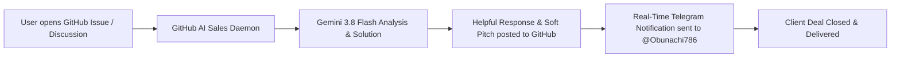

# 🤖 GitHub AI Sales & Lead Generation Agent (Gemini 3.8 Flash + Telegram)

[](https://python.org)
[](https://ai.google.dev/)
[](https://t.me/Obunachi786)
[](LICENSE)

**GitHub AI Sales Agent** is an autonomous background AI agent designed to monitor issues, questions, discussions, and feature inquiries across all your GitHub repositories in real time. Powered by **Google Gemini 3.8 Flash**, it generates helpful, highly professional technical responses, subtly pitches commercial software licenses and custom development services, and immediately routes qualified leads to the developer's Telegram account.

---

## 🌟 Key Features

1. **24/7 Autonomous Repository Monitoring:**
   - Continuously inspects all public repositories (or specified watchlists) via the official GitHub CLI (`gh`).
   - Instantly detects newly opened Issues, questions, bug reports, and commercial inquiries.

2. **Gemini 3.8 Flash Sales Intelligence:**
   - Multi-lingual fluency: replies in the exact language the user wrote (English, Russian, Uzbek, Spanish, etc.).
   - Solution-first philosophy: provides a genuine, technically sound answer to the user's inquiry first.
   - High-conversion soft pitch: introduces turnkey source code templates, licenses, or custom engineering services.
   - Built-in resilience: seamless automatic fallback across Gemini model tiers (`gemini-3.8-flash`, `gemini-3.7-flash`, `gemini-3.5-flash`).

3. **Instant Telegram Lead Dispatch:**
   - Every detected lead, posted response, and original inquiry is delivered straight to the owner's Telegram (@Obunachi786) via bot notifications.

4. **Zero-Duplicate State Management:**
   - Every processed item is tracked in a local state store (`processed_items.json`) to prevent redundant answers or spam.

---

## 🏗️ Architecture Workflow



---

## ⚙️ Installation & Quickstart

### 1. Prerequisites
* Python 3.10 or higher
* [GitHub CLI (`gh`)](https://cli.github.com/) installed and authenticated (`gh auth login`).
* Google Gemini API Key (`GEMINI_API_KEY` or `GOOGLE_API_KEY`).
* Telegram Bot Token and Admin Chat ID.

### 2. Setup
```bash
git clone https://github.com/afzalbek-dev/github-ai-sales-agent.git
cd github-ai-sales-agent
pip install -r requirements.txt
```

### 3. Configuration
Set environment variables or edit the top of `agent.py`:
```bash
export GITHUB_USER="afzalbek-dev"
export GEMINI_API_KEY="YOUR_GEMINI_API_KEY"
export TELEGRAM_BOT_TOKEN="YOUR_TELEGRAM_BOT_TOKEN"
export ADMIN_TELEGRAM_ID="7196940979"
```

### 4. Running the Agent

Run a single audit cycle:
```bash
python3 agent.py --once
```

Run as a continuous 24/7 background daemon:
```bash
nohup python3 agent.py > agent_stdout.log 2>&1 &
```

---

## 💼 Author & Inquiries

Built and maintained by **Afzalbek Abduraimov**:
* Telegram: [@Obunachi786](https://t.me/Obunachi786)
* GitHub: [@afzalbek-dev](https://github.com/afzalbek-dev)
* Featured Products: [TeleShop TMA](https://github.com/afzalbek-dev/teleshop-tma), [TEZish WebApp](https://github.com/afzalbek-dev/tezish-webapp)

---

## 📄 License
This project is licensed under the MIT License — see the [LICENSE](LICENSE) file for details.
